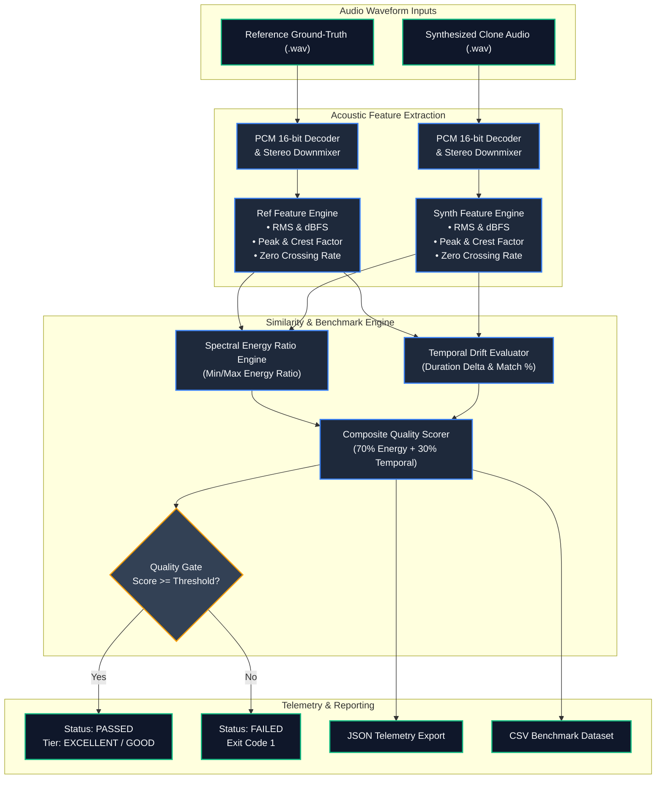

# 📊 voice-clone-evaluator

> **Topics:** `voice-cloning` `speech-synthesis` `audio-similarity` `acoustic-analysis` `xtts` `rvc` `speech-metrics`


[](https://github.com/shadialhasan/voice-clone-evaluator/releases/tag/v1.0.0)
[](LICENSE)
[](https://github.com/shadialhasan/voice-clone-evaluator/actions/workflows/ci.yml)
[](https://github.com/shadialhasan)
[](https://python.org)
[](https://docs.pytest.org)

An enterprise evaluation and benchmark harness for calculating acoustic energy, spectral centroid consistency, temporal alignment, and dynamic range similarity between ground-truth reference audio and synthesized AI voice clones (XTTS, ElevenLabs, VITS, StyleTTS2).

---

## 🏗️ Architecture & Evaluation Pipeline

The diagram below illustrates the acoustic extraction, metric calculation, scoring engine, and reporting pipeline:



---

## ✨ Features

- **Multi-Factor Acoustic Scoring:** Computes Root Mean Square (RMS) energy, dBFS levels, Peak Amplitudes, Crest Factors, and Zero Crossing Rates (ZCR).
- **Composite Quality Tiers:** Categorizes synthesis quality into `EXCELLENT`, `GOOD`, `ACCEPTABLE`, or `POOR` based on customizable thresholds.
- **CI/CD Quality Gate Integration:** Returns exit code `0` on success and `1` on failure, allowing automated blocking of regressions in voice training pipelines.
- **Verbose Metric Exports:** Export comprehensive acoustic datasets into structured `.json` and appendable `.csv` formats.
- **Automated Tests:** 16 automated Pytest tests validating mathematical consistency, silence handling, downmixing, and file exports.

---

## 🚀 Installation & Quick Start

```bash
# Clone the repository
git clone https://github.com/shadialhasan/voice-clone-evaluator.git
cd voice-clone-evaluator

# Install dependencies
pip install -r requirements.txt
```

### Environment Configuration
```bash
cp .env.example .env
```

| Variable | Default | Description |
| :--- | :--- | :--- |
| `SIMILARITY_THRESHOLD` | `80.0` | Minimum composite score to pass quality gate |
| `DEFAULT_SAMPLE_RATE` | `44100` | Target reference sample rate |
| `VERBOSE_OUTPUT` | `false` | Enable verbose terminal acoustic breakdown |
| `METRICS_EXPORT_PATH` | `metrics_summary.json` | Default export location |

---

## 💻 CLI Usage

### Basic Evaluation
```bash
python evaluator.py --ref ground_truth.wav --synth cloned_xtts.wav
```

### Verbose Evaluation with Automated Exports & Strict Quality Gate
```bash
python evaluator.py \
  --ref studio_actor.wav \
  --synth elevenlabs_cloned.wav \
  --threshold 85.0 \
  --verbose \
  --export-json eval_report.json \
  --export-csv historical_benchmarks.csv
```

---

## 🧪 Testing

Run the unit tests locally:
```bash
pytest -v tests/
```

---

## 👤 Author & Maintainer

**Eng. MHD. Shadi AL-Hasan**  
- **Role:** Executive CTO & Enterprise Solutions Architect  
- **Email:** [mhd.shadi.alhasan@gmail.com](mailto:mhd.shadi.alhasan@gmail.com)  
- **Phone / WhatsApp:** [+963934005922](tel:+963934005922)  
- **Location:** Damascus, Syria  
- **GitHub:** [shadialhasan](https://github.com/shadialhasan)  

---

## 📄 License

This project is licensed under the MIT License - see the [LICENSE](LICENSE) file for details.  
Copyright (c) 2026 **MHD. Shadi AL-Hasan**. All rights reserved.